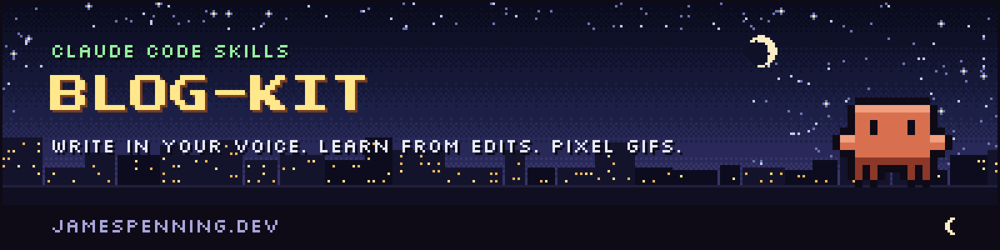
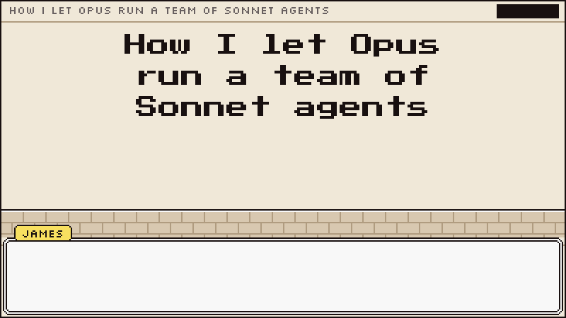

<a href="https://jamespenning.dev">
  <picture>
    <source media="(prefers-color-scheme: dark)" srcset="assets/header-night.png">
    <source media="(prefers-color-scheme: light)" srcset="assets/header-day.png">
    
  </picture>
</a>

**blog-kit** is the [Claude Code](https://docs.claude.com/en/docs/claude-code) skills I use to run my blog,
[jamespenning.dev](https://jamespenning.dev). Two of them make a loop that gets closer to your
voice every time you edit a draft. The third makes 8-bit GIFs about working with agents.

| Skill | What it does |
| --- | --- |
| [write-in-my-voice](skills/write-in-my-voice/SKILL.md) | Drafts in your voice from a voice guide built from your own writing, judges its own draft (3 fixes a round, 3 rounds max), and predicts the edits you'll make. |
| [learn-from-edits](skills/learn-from-edits/SKILL.md) | Diffs your edits to its draft, scores its predictions, and promotes a pattern into the voice guide once it shows up in three pieces. |
| [pixel-gif](skills/pixel-gif/SKILL.md) | Storyboards a post into an 8-bit GIF: an Opus crab with a crown runs Sonnet worker crabs, and you're in it too. |



## Install

As a plugin, inside Claude Code:

```
/plugin marketplace add Kingjbonex/blog-kit
/plugin install blog-kit@kingjbonex
```

Or copy a skill folder into your project's `.claude/skills/` (or `~/.claude/skills/` for every
project).

## How the voice loop works

1. **Set up once.** `write-in-my-voice` copies its templates into a `writing/` folder and builds
   `voice.md` from 3 to 5 things you wrote yourself. Every rule quotes the sample it came from.
2. **Draft.** Anything only you can know (a story, a number, an opinion) becomes a
   `**[AUTHOR: ...]**` gap instead of being made up.
3. **Judge and predict.** Claude fixes the three biggest voice misses per round, then writes down the
   edits it expects you to make.
4. **Edit, then learn.** You edit and commit. `learn-from-edits` diffs your commit, scores the
   predictions and tallies patterns. One edit is a hypothesis; three pieces make a rule.


The loop is adapted from Nat Eliason's "How to Build an AI Writing System That Actually Sounds Like
You", with the reader pass and directed-feedback questions from Gergely Orosz's "Becoming a better
writer" (The Pragmatic Engineer).

## Pixel GIFs

Needs Python 3 and Pillow. See [skills/pixel-gif/README.md](skills/pixel-gif/README.md) for the
style rules and helpers.

```sh
pip install pillow
python3 skills/pixel-gif/scenes/opus-runs-sonnet-agents.py --preview
```

The crabs are original pixel art, not official Anthropic artwork. This repo isn't affiliated with or
endorsed by Anthropic.

## License

MIT. The two pixel fonts are SIL OFL 1.1.
